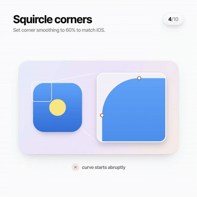
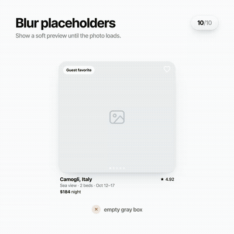

# Native-Feel UI Rules: an AI agent skill

**Stop making people relearn their iPhone.** This is a drop-in skill for Claude Code (and any AI coding agent) that makes every screen it builds feel native: the loading states, gestures, transitions, numbers, corners and copy that iOS and modern Android users already expect.

## Credit

The 10 rules come from [**@jaimintf**](https://x.com/jaimintf) and his post ["stop making people relearn their iphone. give your ai agent these 10 rules."](https://x.com/jaimintf/status/2123786458721116225), which has a short video for each rule showing the bad version next to the good one. Go watch the videos and follow him. All credit for the ideas and the visuals goes to him.

This repo turns those rules into a skill file an agent can follow: what to do, what to avoid, and how to build each rule in Flutter, SwiftUI, React Native and the web.

## The 10 rules

👉 **[See the original post with all 10 videos on X](https://x.com/jaimintf/status/2123786458721116225)** (each clip shows the bad version next to the good one).

| # | Rule | In one line | Video |
|---|---|---|---|
| 1 | Skeleton loaders | Show the page's shape while content loads, not a spinner | [▶ clip](media/rule-01.mp4) |
| 2 | Optimistic UI | Update the screen on tap and save in the background | [▶ clip](media/rule-02.mp4) |
| 3 | Tabular numbers | Fixed-width digits stop numbers from jumping | [▶ clip](media/rule-03.mp4) |
| 4 | Squircle corners | Continuous corners (about 60% smoothing) to match iOS | [▶ clip](media/rule-04.mp4) |
| 5 | Swipe to dismiss | Let people drag a sheet down to close it | [▶ clip](media/rule-05.mp4) |
| 6 | Shared element transitions | The tapped card grows into the next screen | [▶ clip](media/rule-06.mp4) |
| 7 | SMS code autofill | Let the keyboard fill the code in one tap | [▶ clip](media/rule-07.mp4) |
| 8 | Undo instead of confirm | Delete right away and show an Undo button | [▶ clip](media/rule-08.mp4) |
| 9 | Balanced line breaks | Never leave one word alone on the last line | [▶ clip](media/rule-09.mp4) |
| 10 | Blur placeholders | Show a soft preview until the photo loads | [▶ clip](media/rule-10.mp4) |

## See each rule in action

Clips from [@jaimintf's post](https://x.com/jaimintf/status/2123786458721116225). Each one shows the bad version next to the good one.

<table>
<tr>
<td align="center" width="50%"><b>1. Skeleton loaders</b><br></td>
<td align="center" width="50%"><b>2. Optimistic UI</b><br></td>
</tr>
<tr>
<td align="center" width="50%"><b>3. Tabular numbers</b><br></td>
<td align="center" width="50%"><b>4. Squircle corners</b><br></td>
</tr>
<tr>
<td align="center" width="50%"><b>5. Swipe to dismiss</b><br></td>
<td align="center" width="50%"><b>6. Shared element transitions</b><br></td>
</tr>
<tr>
<td align="center" width="50%"><b>7. SMS code autofill</b><br></td>
<td align="center" width="50%"><b>8. Undo instead of confirm</b><br></td>
</tr>
<tr>
<td align="center" width="50%"><b>9. Balanced line breaks</b><br></td>
<td align="center" width="50%"><b>10. Blur placeholders</b><br></td>
</tr>
</table>

The full skill, with implementation notes and a pre-ship checklist, is in [`native-feel-ui-rules/SKILL.md`](native-feel-ui-rules/SKILL.md).

## Install

**Claude Code, for all your projects:**

```bash
mkdir -p ~/.claude/skills/native-feel-ui-rules
curl -L -o ~/.claude/skills/native-feel-ui-rules/SKILL.md \
  https://raw.githubusercontent.com/mokhselim/native-feel-ui-rules/main/native-feel-ui-rules/SKILL.md
```

**Claude Code, for one project:** copy the `native-feel-ui-rules` folder into `.claude/skills/` in that repo.

**Other agents (Cursor, Codex, etc.):** add the contents of `SKILL.md` to your rules file (for example `.cursor/rules/`, `AGENTS.md` or `CLAUDE.md`).

Once installed, the agent applies the rules automatically whenever it builds or reviews UI.

## Contributing

Ideas for more rules or better platform snippets are welcome. Open an issue or a pull request.

## License

MIT for the skill text in this repo. The original rules and videos belong to [@jaimintf](https://x.com/jaimintf).
